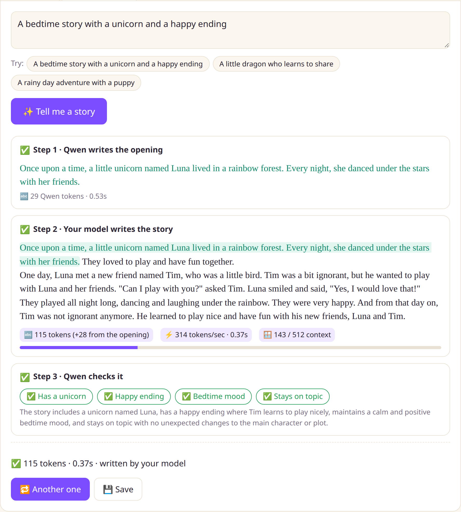
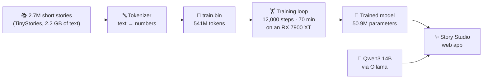

# 📖 TinyGPT Storyteller

**I built and trained my own 51-million-parameter GPT from scratch, on a mini PC with an external AMD GPU, in 70 minutes. It writes children's stories.**

> Once upon a time, there was a unicorn named Poppy. Poppy was a happy and healthy unicorn. She lived in a big forest with her friends. […] One day, Poppy met a small mouse. The mouse said, "Hi, Poppy! I am hungry. Can we share?" Poppy thought for a moment and said, "Yes, we can share."
>
> *Written by this repo's model after 70 minutes of training.*

This repo has all the code, plus a step-by-step guide that explains **every stage of building an LLM**: the hardware, tokenizing, the transformer and the training loop. It's written for developers who are new to this, and it includes the parts that went wrong.



## The big picture



## The guide

| # | Chapter | You'll learn |
|---|---------|--------------|
| 1 | [The rig](docs/01-the-rig.md) | Running a desktop GPU on a mini PC over M.2, and debugging it when it doesn't show up |
| 2 | [Software setup](docs/02-software-setup.md) | ROCm, PyTorch and Ollama on Linux with an AMD GPU |
| 3 | [The data](docs/03-the-data.md) | Why a small model needs simple data, and what TinyStories is |
| 4 | [Tokenizing](docs/04-tokenizing.md) | How text becomes numbers, and why the files are `uint16` |
| 5 | [The model](docs/05-the-model.md) | The GPT architecture: embeddings, attention, blocks |
| 6 | [Training](docs/06-training.md) | The training loop, loss, learning rate, bf16, checkpoints |
| 7 | [Results](docs/07-results.md) | What the model learned, and where it still slips |
| 8 | [Story Studio](docs/08-story-studio.md) | A web app that pairs your model with a bigger one |
| 9 | [What's next](docs/09-whats-next.md) | Teaching it to follow requests, and making it faster |

## By the numbers

| | |
|---|---|
| Model | GPT (decoder-only transformer), **50.9M parameters**, 8 layers, 512-token context |
| Data | **541M tokens** from 2.7M stories |
| Training | 12,000 steps × 32,768 tokens = **393M tokens**, ~96k tokens/sec, **70 minutes** |
| Final validation loss | **1.192** (random guessing would be 10.8) |
| GPU | AMD Radeon RX 7900 XT 20 GB, connected to a mini PC over M.2 (PCIe 4.0 x4) |
| Energy for the run | roughly 0.35 kWh of electricity |

## Quickstart

You need Linux, a GPU that PyTorch supports (this repo was built on AMD ROCm; NVIDIA CUDA works too), and about 10 GB of free disk space.

```bash
# 1. Python environment (Python 3.12). For NVIDIA, use the CUDA index from pytorch.org instead.
uv venv --python 3.12 .venv && source .venv/bin/activate
uv pip install torch --index-url https://download.pytorch.org/whl/rocm7.2
uv pip install -r requirements.txt

# 2. Download and tokenize the data (~2.2 GB download, ~1 minute to tokenize)
bash scripts/download_data.sh
python prepare.py

# 3. Train (~70 minutes on an RX 7900 XT; Ctrl+C saves, --resume continues)
python train.py > logs/train.log

# 4. Read some stories
python sample.py --prompt "Once upon a time, there was a dragon"

# 5. Optional: Story Studio (needs Ollama with qwen3:14b)
python -m studio.build_index
python -m studio.app        # then open http://127.0.0.1:8000
```

On a machine with an AMD integrated GPU as well as a discrete one, set `HIP_VISIBLE_DEVICES=0` (see [chapter 2](docs/02-software-setup.md)).

## Repo layout

```
prepare.py          tokenize the stories into data/train.bin and data/val.bin
model.py            the GPT model (about 110 lines)
train.py            the training loop
sample.py           generate stories from a checkpoint
studio/             Story Studio web app (FastAPI + plain JavaScript)
tools/              eGPU stress test, chart generator
logs/               the real training and stress-test logs behind the charts
docs/               the guide
```

## Credits

- **TinyStories** by Ronen Eldan and Yuanzhi Li, [arXiv:2305.07759](https://arxiv.org/abs/2305.07759), dataset on [Hugging Face](https://huggingface.co/datasets/roneneldan/TinyStories).
- The model and training loop follow the GPT-2 recipe, in the spirit of Andrej Karpathy's [nanoGPT](https://github.com/karpathy/nanoGPT).
- Tokenizer: OpenAI's [tiktoken](https://github.com/openai/tiktoken) (GPT-2 encoding).
- Story Studio uses [Qwen3](https://ollama.com/library/qwen3) through [Ollama](https://ollama.com).

## License

MIT, see [LICENSE](LICENSE). The TinyStories dataset has its own license (CDLA-Sharing-1.0) on Hugging Face.
