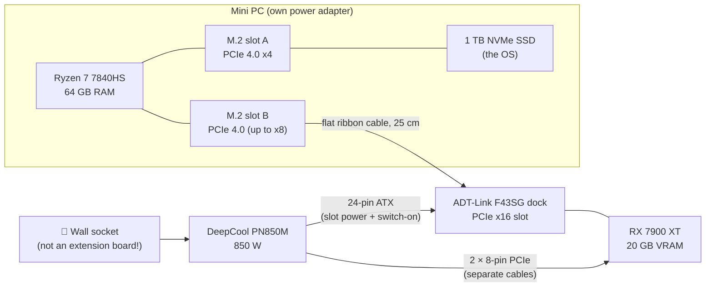
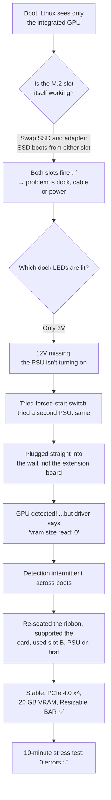
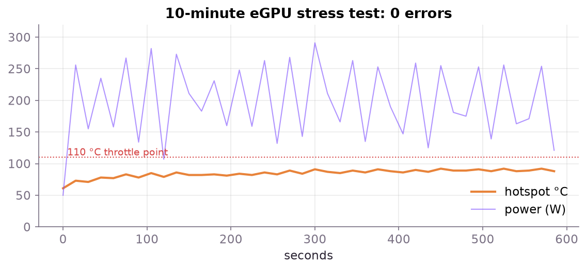

# Chapter 1 · The rig: a desktop GPU on a mini PC

Training a model needs a GPU with plenty of fast memory. I had a compact mini PC and a desktop graphics card, so I connected them through the mini PC's SSD slot. This chapter covers how that works, what it cost, and the debugging it took to get going. That debugging is the part most guides skip.

## The parts

| Part | What I used | Why it matters |
|------|-------------|----------------|
| Computer | Mini PC: AMD Ryzen 7 7840HS (8 cores), **64 GB RAM**, Radeon 780M integrated graphics | The CPU feeds data to the GPU; 64 GB of RAM leaves room for big datasets |
| GPU | Sapphire **AMD Radeon RX 7900 XT, 20 GB** | 20 GB of VRAM holds the model, its gradients and big batches. It's also enough to run 14B-parameter chat models |
| eGPU dock | **ADT-Link F43SG**, M.2 NVMe → PCIe x16 slot | Turns a spare SSD slot into a graphics-card slot |
| Power supply | **DeepCool PN850M**, 850 W 80+ Gold | Powers the dock and GPU only; the mini PC keeps its own adapter |
| OS | Zorin OS 18 (based on Ubuntu 24.04) | Any recent Ubuntu-based distro works the same way |



> [!NOTE]
> **Why not just use the integrated GPU?** The Radeon 780M shares system RAM and has a fraction of the compute. In our tests it isn't even supported by the ROCm libraries that PyTorch and Ollama use (its chip is `gfx1103`). The 7900 XT is `gfx1100`, which is officially supported.

## Choosing the power supply

The PSU only powers the dock and the card, not the computer. The 7900 XT's rated board power is about 315 W, and AMD cards can spike above that for milliseconds. So:

- **750 W** is enough; **850 W** gives comfortable headroom and runs quieter.
- Use **one cable per 8-pin connector** on the card. Avoid the "pigtail" second plug on one cable.
- For hours-long training runs, a **fluid-dynamic-bearing (FDB) fan** and **Japanese capacitors** are worth paying a little more for.

During our 10-minute stress test the card peaked at **308 W**. An 850 W unit was never close to its limit.

## How fast is an M.2 link?

A desktop slot gives the GPU 16 PCIe lanes. An M.2 slot gives it 4. Here's how much that matters:

| Workload | Does the narrow link hurt? |
|----------|----------------------------|
| **Training a small model** | Barely. The model, gradients and batches all stay on the GPU; only a small batch of token IDs crosses the link each step |
| **Running a chat model** | Only while loading it. Once it's in VRAM, very little data crosses the link |
| **Gaming** | Somewhat, typically 10–20% at PCIe 4.0 x4 |
| **Models bigger than VRAM** | Yes, a lot. Spilling into system RAM over x4 is slow |

We measured **7.06 GB/s to the GPU and 7.14 GB/s back**, about 90% of PCIe 4.0 x4's theoretical maximum.

## The debugging story 🕵️

Plugging everything in did not just work. Here's what happened, in order, because you may hit the same problems.



### 1. "Where's my GPU?"

The first boot showed only the integrated GPU:

```console
$ lspci -nn | grep -Ei "vga|display"
c5:00.0 VGA compatible controller: AMD/ATI Phoenix1 [1002:15bf]
```

> [!TIP]
> **The BIOS's "NVMe configuration" page will never list a GPU**, even a working one. It only lists storage. Don't use it to check the eGPU.

`lspci -tv` shows the PCIe tree. Each M.2 slot hangs off its own "root port", and **the BIOS hides a root port when nothing links up on it at boot**. The adapter's slot had simply vanished, which meant the link never came up at all. So it wasn't a driver problem.

### 2. Is the slot OK? Swap things around

I moved the SSD into the adapter's slot and the adapter into the SSD's slot. Linux booted fine from the SSD in either slot, so **both M.2 slots worked**, and the problem had to be the dock, the cable or the power.

The swap revealed something useful too: the two slots are different. Slot B's root port supports **up to x8 lanes** (`max 16.0 GT/s PCIe x8`), while slot A's supports x4. Slot B became the eGPU's home.

### 3. Read the dock's LEDs

The F43SG has four LEDs: **CLK** (clock signal from the PC), **RST** (the PC releasing the card to start), **12V** (power from the PSU) and **3V**. Only **3V** was lit, so **12V was missing, and the PSU wasn't switching on.**

- Setting the dock's SW1 switch to "forced start" didn't help.
- **A second PSU, a Corsair RM850e, behaved exactly the same.** Two PSUs failing identically meant the PSU wasn't the problem.
- The common factor was the **extension board** both PSUs were plugged into. Plugged straight into a wall socket, the PSU started, 12V came on, and Linux saw the card.

> [!IMPORTANT]
> **Plug your GPU's power supply directly into a wall socket.** Cheap extension boards can have loose sockets, per-socket switches or tripped fuses. For hours of sustained 250–300 W load, use a wall socket or a proper surge protector.

### 4. Detected, but "vram size read: 0"

The card appeared, but the driver gave up:

```console
amdgpu 0000:03:00.0: failed to read discovery info from memory, vram size read: 0
amdgpu 0000:03:00.0: Fatal error during GPU init
```

The PCIe interface was talking, but the GPU core wasn't fully up. On the next few boots the card wasn't detected at all. **An intermittent link usually means a marginal connection.** A flat ribbon cable running at PCIe 4.0 speed (16 GT/s) has little margin for error.

What I did, in no particular order. I can't tell you which one was the real fix:

- Re-seated the M.2 adapter and both ends of the ribbon, and removed a crease in it.
- Put a support under the heavy card so it sits level in the dock's slot.
- Used slot B, the x8-capable one.
- Switched the PSU on a few seconds before the mini PC (SW1 at "forced start"), so the card is fully awake before the PC looks for it.

My BIOS has no setting to force PCIe Gen3, which is the usual fix for a marginal riser. I prepared a Smokeless UMAF USB stick (a community tool that exposes hidden AMD BIOS menus) as a fallback, but in the end I didn't need it.

### 5. Prove it: the stress test

"Detected" isn't the same as "reliable". Before trusting the link with hours of training, I ran [tools/egpu_stress.py](../tools/egpu_stress.py) for 10 minutes. It loops three checks:

1. **Compute:** large matrix multiplications, compared against a known-good result
2. **VRAM:** fills 15.8 GiB with a pattern and reads it all back
3. **PCIe:** copies 512 MB to the GPU and back and compares every byte



| Check | Result |
|-------|--------|
| Compute | 19.7 TFLOPS FP32, **0 mismatches** |
| VRAM | ~5.3 TB written and verified, **0 errors** |
| PCIe | ~1.4 TB copied, **0 corrupted bytes**, Gen4 x4 throughout |
| Kernel log | No PCIe errors, resets or hangs |

Afterwards, the 70-minute training run went through without a single error, which is the real proof.

```bash
# Quick 2-minute health check after any boot:
HIP_VISIBLE_DEVICES=0 python tools/egpu_stress.py 120
```

## Lessons

1. **Read the dock's LEDs first.** They tell you whether it's a power problem or a signal problem.
2. **Change one thing at a time**, and swap parts to isolate the cause (two PSUs → not the PSU).
3. **`lspci -tv` and `dmesg` don't lie;** BIOS screens often just don't show what you need.
4. **Stress-test before you trust it.** A link that drops mid-training costs you the run, so save checkpoints often (see [chapter 6](06-training.md)).

---
Next: [Chapter 2 · Software setup →](02-software-setup.md)
