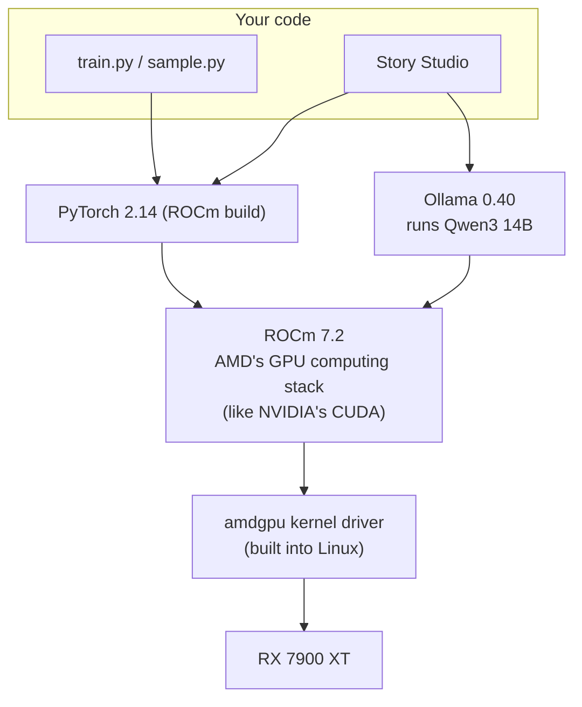

# Chapter 2 · Software setup: ROCm, PyTorch and Ollama

With the hardware working, we need three pieces of software:



## ROCm: AMD's answer to CUDA

**ROCm** is the software that lets programs run general computations on AMD GPUs. The good news: **you don't need to install it system-wide.** PyTorch's ROCm builds and Ollama each bundle the ROCm libraries they need. All the system needs is the `amdgpu` kernel driver, which ships with Linux.

Two small things are needed:

```bash
# 1. Let your user access the GPU (log out and back in afterwards)
sudo usermod -aG render,video $USER

# 2. Check the driver sees the card with all its memory
sudo dmesg | grep -i "VRAM memory ready"
# amdgpu 0000:07:00.0:  20464M of VRAM memory ready
```

## PyTorch in its own environment

The repo is a [uv](https://docs.astral.sh/uv/) project. [pyproject.toml](../pyproject.toml) lists the packages, and `uv.lock` pins the exact version of every one, so you get the same environment I trained with. One command creates `.venv`, downloads Python 3.12 if you don't have it, and installs everything:

```bash
uv sync --extra rocm      # AMD; use --extra cuda for NVIDIA, --extra cpu for no GPU
```

PyTorch publishes a separate build for each kind of GPU, each on its own package index. The three *extras* in `pyproject.toml` point `torch` at the right one:

```toml
[tool.uv.sources]
torch = [
    { index = "pytorch-rocm", extra = "rocm" },   # download.pytorch.org/whl/rocm7.2
    { index = "pytorch-cuda", extra = "cuda" },   # download.pytorch.org/whl/cu130
    { index = "pytorch-cpu", extra = "cpu" },     # download.pytorch.org/whl/cpu
]
```

After that, run any script with `uv run`. It uses `.venv` automatically, so there's no `source .venv/bin/activate` to forget:

```bash
uv run sample.py --prompt "Once upon a time"
uv run uv run python -m studio.app
```

> [!NOTE]
> PyTorch's ROCm build still uses the `torch.cuda` names. `torch.cuda.is_available()` returning `True` on an AMD card is expected, not a mistake.

Check it:

```console
$ uv run python -c "import torch; print(torch.__version__, torch.cuda.device_count())
for i in range(torch.cuda.device_count()): print(i, torch.cuda.get_device_name(i))"
2.14.1+rocm7.2 2
0 Radeon RX 7900 XT
1 AMD Radeon 780M Graphics
```

### ⚠️ Hide the integrated GPU

PyTorch sees **both** GPUs. The 780M (`gfx1103`) isn't supported by PyTorch's ROCm kernels, and code that touches it can crash or run on the wrong device. The fix is one environment variable:

```bash
export HIP_VISIBLE_DEVICES=0   # only show GPU 0, the RX 7900 XT
```

Story Studio sets this itself. For the training scripts, put it in your `~/.bashrc` or in front of each command.

## Ollama for a ready-made chat model

[Ollama](https://ollama.com) downloads and runs open models with one command. Its installer detects an AMD GPU and adds its ROCm package:

```bash
curl -fsSL https://ollama.com/install.sh -o ollama-install.sh   # read it first!
sh ollama-install.sh
ollama pull qwen3:14b
```

Its log shows it picking the right GPU and skipping the integrated one by itself:

```text
msg="dropping ROCm device — no rocblas support for gfx target" gfx_target=gfx1103
msg="inference compute" library=ROCm compute=gfx1100 description="AMD Radeon RX 7900 XT" total="20.0 GiB"
```

```console
$ ollama ps
NAME         SIZE      PROCESSOR    CONTEXT
qwen3:14b    9.7 GB    100% GPU     4096
```

Qwen3 14B generates about **63 tokens/sec** on this card and loads in **3.9 s** over the M.2 link. Story Studio uses it in [chapter 8](08-story-studio.md).

**Models that fit in 20 GB:** `qwen3:14b` (~9 GB), `gpt-oss:20b` (~14 GB), `gemma3:12b` (~8 GB) and `qwen3:30b-a3b` (~19 GB, tight).

## Optional: faster training with `torch.compile`

`torch.compile` can make training noticeably faster. It compiles small C helpers on first use, so it needs Python's development headers. Without them you'll see `CalledProcessError: ... gcc ... hip_utils.c`:

```bash
sudo apt install python3.12-dev
uv run train.py --compile
```

I trained without it, at about 96k tokens/sec.

---
← [Chapter 1 · The rig](01-the-rig.md) · Next: [Chapter 3 · The data →](03-the-data.md)
