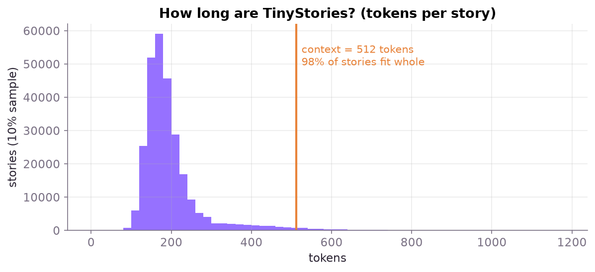
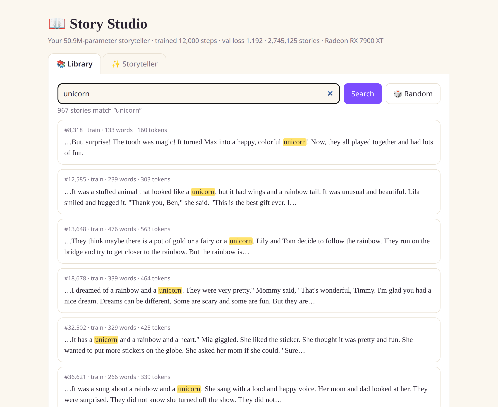

# Chapter 3 · The data: why TinyStories?

A language model learns only from the text you feed it. A model with 50 million parameters is *tiny* next to GPT-4 or Qwen, and if you train it on Wikipedia or the open web it ends up knowing a little about everything and writing nonsense about all of it.

The insight behind **TinyStories** ([Eldan & Li, 2023](https://arxiv.org/abs/2305.07759)) is to **shrink the world, not just the model.** The researchers had GPT-3.5 and GPT-4 write millions of short stories using only the words a 3- to 4-year-old knows. With vocabulary and topics that narrow, even a few-million-parameter model can learn grammar, consistent characters, simple cause and effect, and even dialogue.

> [!TIP]
> **🧠 Why this matters:** the right dataset for a small model is one where it can actually *finish learning the patterns*. That's why a 51M model can write a coherent story here, while the same model trained on the web would babble.

## What's in it

We use the **V2 / GPT-4** version, which contains only stories written by GPT-4 and is higher quality:

| File | Size | Stories | Tokens |
|------|------|---------|--------|
| `TinyStoriesV2-GPT4-train.txt` | 2.2 GB | **2,717,495** | **541,469,395** |
| `TinyStoriesV2-GPT4-valid.txt` | 22 MB | 27,630 | 5,469,024 |

The stories are separated by a special marker, `<|endoftext|>`. A typical one:

> Tom and Mia went to the park with Mom. They saw a big slide that looked like a shark. It had a mouth, teeth, eyes and a fin. Tom and Mia wanted to try the slide. "Can we slide, Mom?" Tom asked. "Sure, but be careful. The slide is very high and fast," Mom said. […]

Download it with:

```bash
bash scripts/download_data.sh   # fetches both files into data/ from Hugging Face
```

## Training data vs validation data

The **validation set** is a separate pile of stories the model **never trains on**. Every 500 steps we measure the model's loss on it:

- If **training loss** falls but **validation loss** doesn't, the model is *memorizing* its training stories instead of learning to write.
- If both fall together, it's genuinely learning patterns that work on new text.

In our run they stayed almost on top of each other the whole way (see [chapter 6](06-training.md)). With 541M tokens and only one pass through ~73% of them, there's simply no time to memorize.

## How long is a story?

Story Studio's index (see [chapter 8](08-story-studio.md)) counts the tokens in every story:



Most stories are **150–250 tokens**, and **98% fit within 512 tokens**. That's why the model's *context window*, the number of tokens it can look at at once, is 512. A longer window would cost more memory and compute for almost no benefit on this data.

## Explore it yourself

Story Studio's **📚 Library** tab lets you search all 2.7M stories. Try searching for "unicorn" (967 stories) or "dragon", or hit 🎲 Random.



---
← [Chapter 2 · Software setup](02-software-setup.md) · Next: [Chapter 4 · Tokenizing →](04-tokenizing.md)
