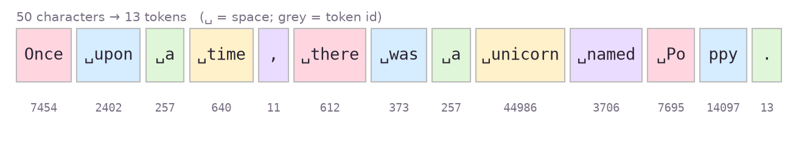
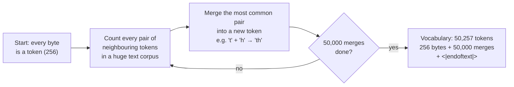
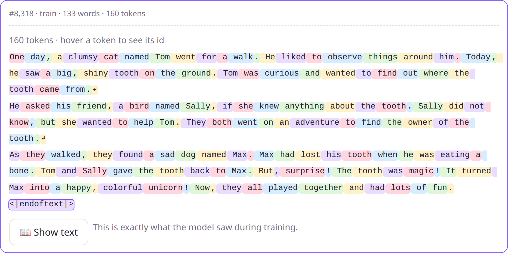
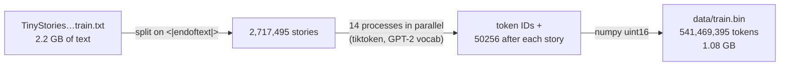

# Chapter 4 · Tokenizing: turning stories into numbers

Neural networks only understand numbers. **Tokenizing** chops text into pieces called *tokens* and gives each piece a number, its *token ID*. The model never sees letters, only sequences of IDs.



That sentence is 50 characters but only **13 tokens**. Notice that:

- **Spaces are attached to the front of words** (`␣upon`, `␣time`). " time" and "time" are different tokens.
- **Common words are a single token.** `␣unicorn` is token 44986.
- **Rarer words get split into pieces.** "Poppy" becomes `␣Po` + `ppy`.

## Why not one token per word, or per letter?

| Approach | Vocabulary | Problem |
|----------|-----------|---------|
| One per **letter** | ~100 | Sequences get very long: a 1,000-character story is 1,000 steps for the model to look at |
| One per **word** | Millions | Any word not seen in training ("Booy", "tyrannosaurus", typos) is impossible to write |
| **Subword pieces (BPE)** | ~50,000 | ✅ Common words are one token, and anything else can still be built from pieces |

## How BPE (byte-pair encoding) builds its vocabulary

GPT-2's tokenizer was built once, by OpenAI, using **byte-pair encoding**:



Because it starts from **bytes**, it can encode *anything*, even emoji. A 🦄 becomes three byte-level tokens: `8582, 99, 226`.

Real examples from our tokenizer:

| Text | Tokens | Pieces |
|------|--------|--------|
| `" unicorn"` | 1 | `␣unicorn` |
| `" Unicorn"` | 1 | `␣Unicorn` (capitalized is a *different* token!) |
| `" unicorns"` | 2 | `␣unic` `orns` |
| `" Poppy"` | 2 | `␣Po` `ppy` |
| `" tyrannosaurus"` | 2 | `␣tyrann` `osaurus` |
| `" 12345"` | 2 | `␣123` `45` |

> [!TIP]
> **🧠 Why this matters:** the tokenizer decides what the model finds "easy". "unicorns" splitting into `␣unic` + `orns` is one reason small models sometimes stumble on plurals of rare words.

We **reuse GPT-2's tokenizer** via OpenAI's `tiktoken` library instead of training our own. It's fast, well tested, and its vocabulary covers simple English well.

## The special token: `<|endoftext|>`

Token **50256** is special. We put it at the end of every story, so the model learns **where stories end**. When it generates `<|endoftext|>`, the story is finished and we stop. Story Studio's token view shows it outlined at the end of every story:



## The code: [prepare.py](../prepare.py)

```python
enc = tiktoken.get_encoding("gpt2")
EOT = enc.eot_token                       # 50256

def encode_batch(stories):
    out = []
    for ids in enc.encode_ordinary_batch(stories):
        out.extend(ids)
        out.append(EOT)                   # mark the end of each story
    return np.array(out, dtype=np.uint16)
```

The script splits the 2.2 GB text into stories, encodes them on all CPU cores in parallel, and writes one long array of token IDs:



```console
$ uv run prepare.py
val.bin: 27,630 stories, 5,469,024 tokens
train.bin: 2,717,495 stories, 541,469,395 tokens
# 43 seconds on a Ryzen 7 7840HS
```

### Why `uint16`?

The biggest token ID is 50,256, and a `uint16` holds numbers up to 65,535, so **every token fits in 2 bytes**. That makes `train.bin` 1.08 GB, about half the size of the original text, because each token covers about **4.1 characters** on average.

The first 20 tokens of `train.bin`:

```text
[7454, 2402, 257, 640, 612, 373, 257, 1310, 2933, 3706, 3932, 13, 3932, 6151, 284, 7301, 262, 995, 1088, 683]
 → "Once upon a time there was a little boy named Ben. Ben loved to explore the world around him"
```

## Loading it during training: memory-mapping

Training doesn't load the 1 GB file into RAM. It **memory-maps** it with `np.memmap`, so the operating system reads only the bytes we touch:

```python
train_data = np.memmap("data/train.bin", dtype=np.uint16, mode="r")

def get_batch(data):
    ix = np.random.randint(0, len(data) - block - 1, batch)   # 32 random starting points
    x = [data[i     : i + block]     for i in ix]             # 512 tokens each
    y = [data[i + 1 : i + 1 + block] for i in ix]             # the same, shifted by one
```

That `y` shifted by one is the whole trick of language modelling, and it's the subject of the next two chapters.

---
← [Chapter 3 · The data](03-the-data.md) · Next: [Chapter 5 · The model →](05-the-model.md)
