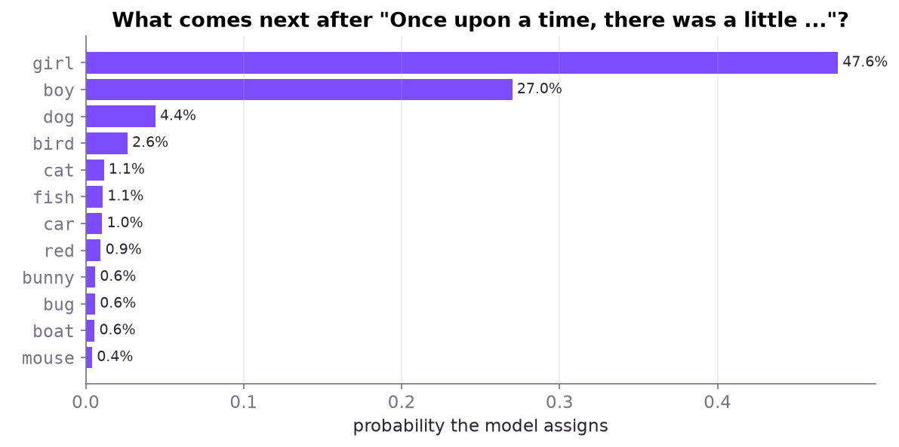
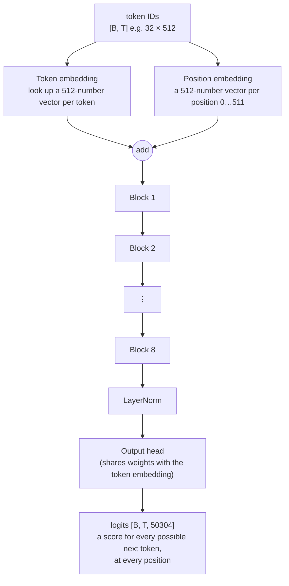
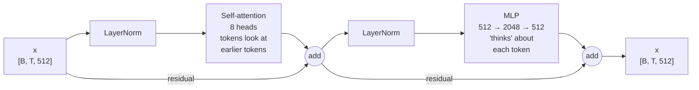
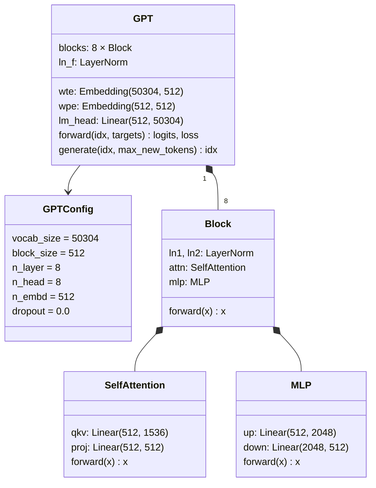

# Chapter 5 · The model: a GPT in about 110 lines

Our model is a **GPT**: a *decoder-only transformer*, the same family as GPT-2, Llama and Qwen, just much smaller. It does exactly one thing:

> **Given some tokens, predict the probability of every possible next token.**



That's our trained model's real output for *"Once upon a time, there was a little …"*. It puts 47.6% on "girl" and 27% on "boy", and spreads the rest over animals. Writing a story is just this, repeated: pick a token from these probabilities, add it to the text, and ask again.

## The whole architecture



`B` = batch (stories processed at once), `T` = time (token positions), `C` = 512 (the size of each token's vector).

All 8 blocks are identical in shape (each has its own weights). Inside each one:



## The code structure: [model.py](../model.py)



## Piece by piece

### 1. Embeddings: from IDs to vectors

A token ID like 44986 (`␣unicorn`) means nothing by itself. The **token embedding** is a big table with one row of 512 learnable numbers per token. Training nudges those numbers until similar tokens get similar vectors.

Attention by itself has no sense of word order, so we add a **position embedding**: another learnable vector for each position from 0 to 511.

### 2. Self-attention: tokens looking at each other

This is the heart of the transformer. For each token, the model builds three vectors:

- **Query:** "what am I looking for?"
- **Key:** "what do I contain?"
- **Value:** "what will I pass on if someone attends to me?"

Each token compares its query with every *earlier* token's key, turns those scores into weights, and takes a weighted mix of their values. That's how `she` can pull in information from `Lily` three sentences earlier.

```python
q, k, v = self.qkv(x).split(C, dim=2)              # one matmul makes all three
q, k, v = (t.view(B, T, 8, 64).transpose(1, 2)     # split into 8 heads of 64
           for t in (q, k, v))
y = F.scaled_dot_product_attention(q, k, v, is_causal=True)
```

**`is_causal=True`** is crucial. It stops each token from looking at tokens *after* it:

```text
            can attend to →
             Once  upon   a   time
  Once        ✅    ❌    ❌    ❌
  upon        ✅    ✅    ❌    ❌
  a           ✅    ✅    ✅    ❌
  time        ✅    ✅    ✅    ✅
```

Without it, training would be cheating: the model could just peek at the answer.

**8 heads** means attention runs 8 times in parallel, each on 64 of the 512 numbers. Different heads learn different jobs: one tracks who "she" is, another tracks quotation marks, and so on.

### 3. The MLP: per-token thinking

After attention mixes information *between* tokens, the MLP processes each token *on its own*: it expands to 2,048 numbers, applies GELU (a smooth "keep positives, squash negatives" function), and shrinks back to 512. Much of a model's "knowledge" is thought to live in these layers.

### 4. Residuals and LayerNorm: keeping deep stacks trainable

Each sub-layer **adds** its output to its input (`x = x + attn(ln1(x))`) instead of replacing it. These *residual connections* give gradients a direct path back through all 8 blocks. **LayerNorm** keeps the numbers in a healthy range. We normalize *before* each sub-layer ("pre-norm"), which is the modern, more stable arrangement.

### 5. The output head and weight tying

The final layer turns each 512-number vector back into **50,304 scores**, one per vocabulary entry. We **tie** its weights to the token embedding: the same table is used for "token → vector" and "vector → token". That saves 25.8M parameters, and works well in practice.

> [!NOTE]
> **Why 50,304 and not 50,257?** We pad the vocabulary up to a multiple of 64. GPU matrix units run faster on round sizes, and the 47 extra tokens are simply never used.

## Where the 50.9M parameters live

| Part | Parameters | Share |
|------|-----------:|------:|
| Token embedding (shared with the output head) | 25,755,648 | **50.6%** |
| 8 blocks × (attention 1.05M + MLP 2.10M + norms) | 25,182,208 | 49.4% |
| Final LayerNorm | 1,024 | ~0% |
| **Total** (position embeddings not counted, by convention) | **50,938,880** | |

Fun fact: **half of the model is just the vocabulary table.** In big models like Qwen3 14B the vocabulary tables are only around 10% of the weights; almost everything is in the blocks.

## Starting from random

Before training, all weights are small random numbers (normal distribution, std 0.02). The residual projections are scaled down by `1/√(2 × layers)` so the sum of 16 residual additions doesn't blow up. That's the GPT-2 recipe:

```python
for name, p in self.named_parameters():
    if name.endswith(("proj.weight", "down.weight")):
        nn.init.normal_(p, std=0.02 / math.sqrt(2 * cfg.n_layer))
```

An untrained model gives every token roughly equal probability, so its loss starts near **ln(50,257) ≈ 10.8**. The next chapter is about bringing that number down.

---
← [Chapter 4 · Tokenizing](04-tokenizing.md) · Next: [Chapter 6 · Training →](06-training.md)
