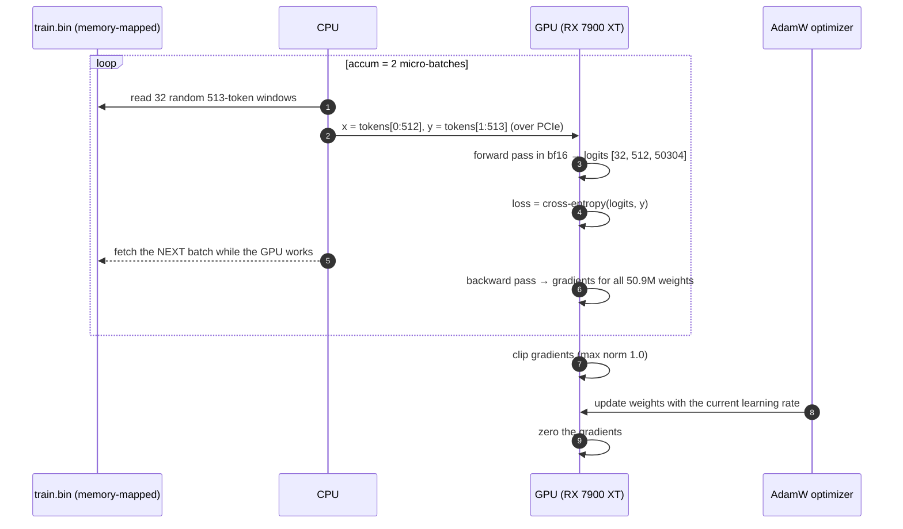
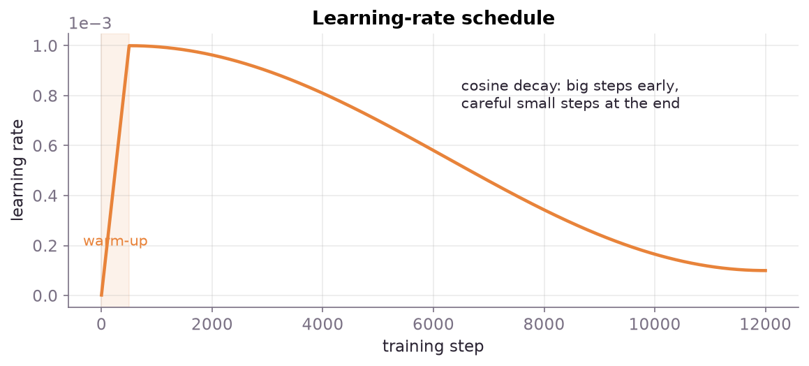
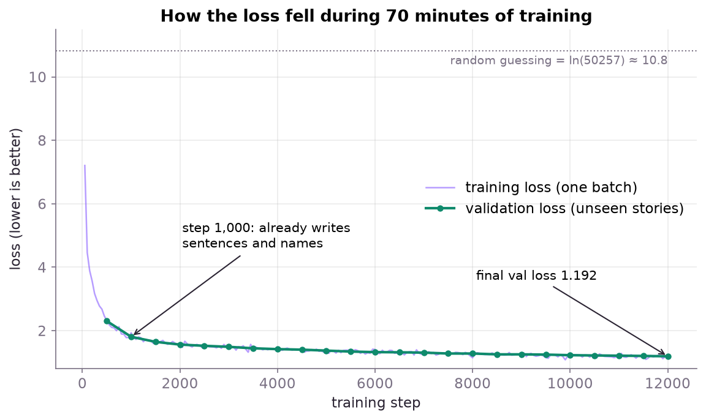
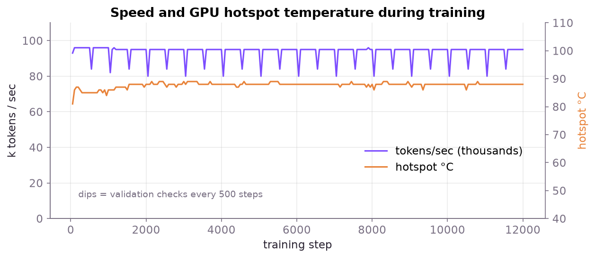
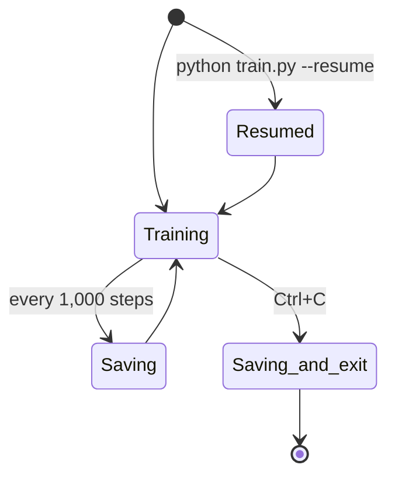

# Chapter 6 · Training: 70 minutes from noise to stories

Training is a loop that runs 12,000 times:

1. Show the model some real text.
2. Measure how badly it predicted each next token (**the loss**).
3. Work out how each of its 50.9M numbers should change to do better (**backpropagation**).
4. Nudge every number a tiny bit in that direction (**the optimizer**).

That's it. Everything else in [train.py](../train.py) is making that loop fast, stable and crash-proof.

## One training step



### Inputs and targets: the "shifted by one" trick

```text
x (input):   Once   upon   a   time   ,     there
y (target):  upon   a      time ,     there  was
```

Every position is a prediction exercise: from "Once", predict "upon"; from "Once upon", predict "a"; and so on. Thanks to the causal mask from [chapter 5](05-the-model.md), **one 512-token window gives 512 training examples at once.** Each step sees 2 × 32 × 512 = **32,768 predictions**.

### The loss: cross-entropy

For each position the model outputs a probability for every token. The loss is **−log(probability it gave to the correct token)**:

| Model gave the right token… | Loss |
|---|---|
| 100% | 0.0 |
| 50% | 0.69 |
| 30% | 1.20 ← where we ended up, on average |
| 1/50,257 (random guess) | 10.8 ← where we started |

A handy translation: **e^loss ≈ how many tokens the model is "torn between."** Our final loss of 1.192 gives e^1.192 ≈ **3.3**. On average, the model has narrowed 50,257 options down to about 3.

## The settings, and why

| Setting | Value | Why |
|---|---|---|
| Batch | 32 stories × 512 tokens | Fills the GPU well without running out of memory |
| Gradient accumulation | 2 | Two micro-batches per update give a 32,768-token "effective batch" for smoother updates |
| Steps | 12,000 | 393M tokens, about 0.73 passes over the data, and about 70 minutes |
| Optimizer | AdamW, β = (0.9, 0.95) | The standard for transformers; keeps a running average of each weight's gradients |
| Weight decay | 0.1 on matrices only | Gently pulls weights towards zero to avoid overfitting; not applied to biases or norms |
| Peak learning rate | 1e-3 | Small models tolerate a higher rate than big ones |
| Gradient clipping | 1.0 | If one batch produces huge gradients, scale them down instead of wrecking the model |
| Precision | bf16 autocast | Matrix math in 16-bit runs about twice as fast; the loss is still computed in 32-bit for accuracy |

### The learning-rate schedule



- **Warm-up (first 500 steps):** at the start the weights are random and gradients are wild, so we ramp the rate up gently.
- **Cosine decay:** big steps while there's a lot to learn, then smaller and smaller steps to settle into a good spot. It ends at 10% of the peak.

## What it looked like

```console
$ python train.py > logs/train.log
GPU: Radeon RX 7900 XT
model: 50.9M params, 8 layers, 512 dim, context 512
data: 541M train tokens, 32,768 tokens/step, 12000 steps = 393M tokens
step     50 | loss 7.206 | lr 1.00e-04 | 93k tok/s | 81C 257W
step    500 | loss 2.320 | lr 1.00e-03 | 96k tok/s | 85C 241W
--- step 500: val loss 2.303 (best 2.303)
step   1000 | loss 1.934 | lr 9.96e-04 | 96k tok/s | 86C 246W
--- step 1000: val loss 1.807 (best 1.807)
...
step  12000 | loss 1.200 | lr 1.00e-04 | 95k tok/s | 88C 256W
--- step 12000: val loss 1.192 (best 1.192)
done
```



Things to notice:

- **Most of the learning happens in the first 1,000 steps** (about 6 minutes). After that, each improvement takes longer.
- **Training and validation loss sit on top of each other.** No overfitting: it's learning to write, not memorizing.
- The training-loss line is jagged because each point is a single batch; validation averages 40 batches.

| Step | Val loss | ≈ tokens it's "torn between" |
|---:|---:|---:|
| 0 | ~10.8 | 50,000 |
| 500 | 2.303 | 10.0 |
| 1,000 | 1.807 | 6.1 |
| 2,000 | 1.561 | 4.8 |
| 4,000 | 1.418 | 4.1 |
| 8,000 | 1.279 | 3.6 |
| 12,000 | **1.192** | **3.3** |

## Speed and heat



- A steady **~96,000 tokens/sec**. The dips are the validation checks every 500 steps.
- That's roughly **6 × 50.9M parameters × 96k tokens ≈ 29 TFLOPS** of useful math, about a quarter to a third of the card's bf16 peak. That's typical for an unoptimized small model; `torch.compile` and fused kernels would raise it.
- The GPU sat at its **~255 W power limit** with a hotspot of **85–89 °C**, safely below the 110 °C throttle point.

> [!TIP]
> For long runs, **cap the power at ~220–240 W** (in LACT, or with `rocm-smi`). You lose only a few percent of speed, and temperatures and fan noise drop a lot.

## Crash-proofing: checkpoints

An eGPU on a ribbon cable can drop out. A power cut can happen. So [train.py](../train.py):

- **saves a checkpoint every 1,000 steps** to `out/ckpt.pt`, with the model, the optimizer state and the step number
- writes it to a temp file first and renames it, so a crash *during* saving can't corrupt it
- **saves on Ctrl+C**, then exits cleanly
- **continues** from the checkpoint with `--resume`



```bash
pkill -INT -f train.py      # stop from another terminal; still saves first
python train.py --resume    # carry on where it stopped
```

> [!NOTE]
> The checkpoint is **587 MB**, not 200 MB. AdamW stores two extra numbers per weight (its running averages), so the optimizer state is twice the size of the model. To *share* a model, save just `model.state_dict()`.

## Always smoke-test first

Before the 70-minute run, a **2-minute, 300-step run** checked that everything worked and measured the speed:

```bash
python train.py --iters 300 --warmup 50 --eval-every 300 --out /tmp/smoke
# ... val loss 2.651 after 300 steps, 96k tok/s
```

It's the cheapest bug-catcher there is.

---
← [Chapter 5 · The model](05-the-model.md) · Next: [Chapter 7 · Results →](07-results.md)
