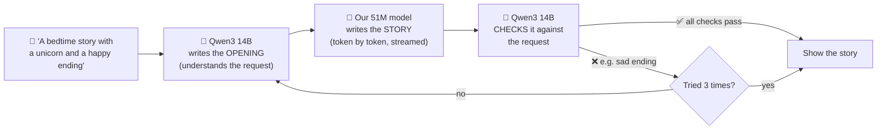
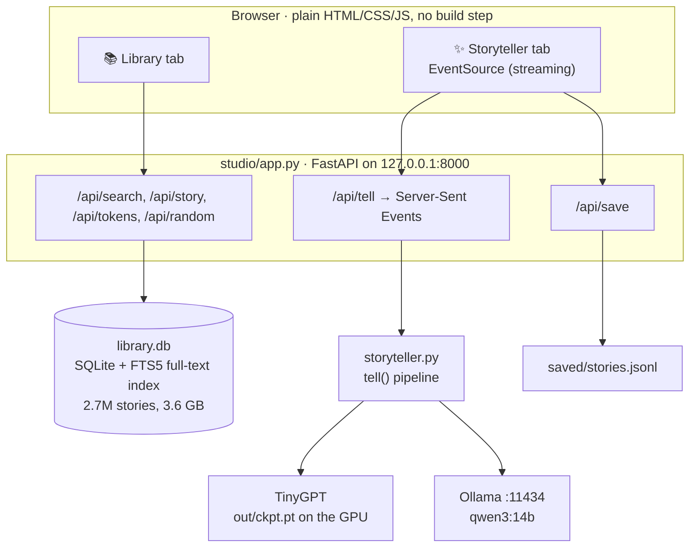
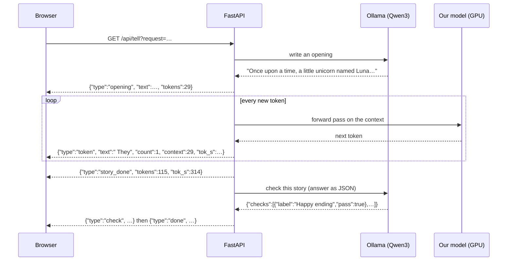

# Chapter 8 · Story Studio: a big model and a small model as a team

Our model writes nice stories but can't follow a request like *"a bedtime story with a unicorn and a happy ending."* Qwen3 14B understands requests perfectly, but it's 290× bigger. **Story Studio** uses each model for what it's good at:



Run it:

```bash
uv run python -m studio.build_index   # once: makes studio/library.db (3.6 GB, about 2 minutes)
uv run python -m studio.app           # open http://127.0.0.1:8000
```

## ✨ The Storyteller tab


1. **Qwen writes the opening.** A system prompt asks for one or two sentences "in the style of TinyStories… simple words a 3-year-old knows… start with 'Once upon a time'". Matching the training data's style matters: our model continues text it recognizes far better.
2. **Our model writes the story,** streamed to the browser token by token. The green highlighted text is Qwen's opening; everything after it is ours. The live counter shows:
   - **🔤 tokens** generated so far, plus how many came from the opening
   - **⚡ tokens/sec**: our model manages 120–310 tokens/sec on the RX 7900 XT
   - **🪟 context used**: how much of the 512-token window is filled. When it's full, the model can't see any more text, so generation stops.
3. **Qwen checks it.** It's asked to derive 2–4 checks from the request ("Has a unicorn", "Happy ending", "Bedtime mood"), always plus "Stays on topic" (catching the unicorn-turns-into-a-penguin problem from [chapter 7](07-results.md)). It answers in **structured JSON** via Ollama's `format` option, so the app never has to parse free text. If any check fails, we start again with a fresh opening, up to 3 times.

## 📚 The Library tab

Search all 2.7M training stories in milliseconds, open any story, and press **🔤 Show tokens** to see exactly how the model saw it (see [chapter 4](04-tokenizing.md)).

## How it's built



### Streaming with Server-Sent Events

`tell()` in [storyteller.py](../studio/storyteller.py) is a Python **generator**: it `yield`s small events as things happen, and the web app forwards each one to the browser immediately:



Two details worth stealing:

- **Decoding token by token is tricky.** One emoji can be 3 tokens, and decoding just the first gives a broken `�` character. So we decode the *whole* continuation each time and only send the new part once it doesn't end in `�`.
- **One GPU, one story at a time.** A lock makes a second request get a polite "busy" message instead of fighting over VRAM.

### Search with SQLite FTS5

[build_index.py](../studio/build_index.py) loads every story into SQLite with its word and token counts, then builds an **FTS5 full-text index** with Porter stemming, so "unicorn" also finds "unicorns". Searching 2.7M stories then takes under 0.1 s, with no search server needed.

## Why is our model "only" 120–310 tokens/sec?

It's much smaller than Qwen, so it *should* be faster still. The reason it isn't: **no KV cache.** For every new token, `generate()` re-runs the model over the *entire* story so far. Big inference engines like Ollama cache each token's attention keys and values, so each new token costs one position, not hundreds. Adding a KV cache is a great next exercise (see [chapter 9](09-whats-next.md)).

---
← [Chapter 7 · Results](07-results.md) · Next: [Chapter 9 · What's next →](09-whats-next.md)
