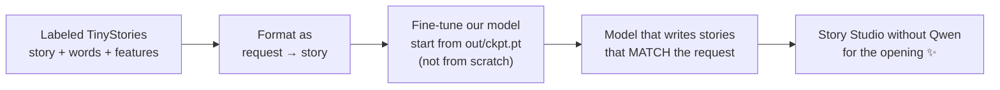

# Chapter 9 · What's next

We have a model that can *write*. The next step is a model that can *listen*.

## 1. Teach it to follow requests (instruction tuning)

Story Studio needs Qwen to understand requests. We can teach our own model to do it, the same way chat models are made: **train on examples of "request → response".**

The TinyStories authors released a labeled version of the data (`TinyStories_all_data.tar.gz`) in which every story comes with the instructions GPT-4 was given when writing it: **words to include**, **features** such as *Dialogue*, *BadEnding*, *Twist* or *MoralValue*, and a one-line **summary**. We can turn each one into a training example like this:

```text
<|request|> Words: unicorn, share, happy. Features: Dialogue, MoralValue.
<|story|> Once upon a time, there was a unicorn named Poppy… <|endoftext|>
```

There's no "HappyEnding" label, but there is *BadEnding*, so "happy ending" can be learned as its absence. (I haven't downloaded the labeled set yet, so check the exact field names when you do.)



The interesting parts to figure out:

- **Loss masking:** only count the loss on the *story* tokens, not the request, so the model learns to answer requests rather than to write them.
- **New special tokens** like `<|request|>`: we have 47 unused vocabulary slots from padding to 50,304 (see [chapter 5](05-the-model.md)).
- **Measuring success:** Qwen's checker from Story Studio becomes an automatic evaluator. What fraction of requests pass?

## 2. Make generation faster with a KV cache

Right now every new token re-processes the whole story. Caching each layer's attention keys and values means each step processes only **one** new token. Expect a large speed-up for long stories.

## 3. Train faster

- `torch.compile` (needs `python3.12-dev`): fuses many small GPU operations into fewer, faster ones.
- A bigger batch: we used about half of the 20 GB of VRAM.
- Measure first: `torch.profiler` shows where the time actually goes.

## 4. Scale up

| Experiment | What to change | What to watch |
|---|---|---|
| Wider/deeper model | `--layers 12 --embd 768` (~124M, GPT-2 small) | Does val loss keep falling? Does it still fit in 20 GB? |
| Train longer | `--iters 30000` (more than one pass) | When does validation loss stop improving? |
| Smaller model | `--layers 4 --embd 256` | How small can it get and still write a story? |

Each experiment is a single command, so it's a great way to build intuition for **scaling laws**: how loss improves with model size and data.

## Things to read

- **TinyStories paper:** Eldan & Li (2023), *How Small Can Language Models Be and Still Speak Coherent English?* [arXiv:2305.07759](https://arxiv.org/abs/2305.07759)
- **Attention Is All You Need:** Vaswani et al. (2017), the original transformer
- **Language Models are Unsupervised Multitask Learners:** the GPT-2 paper
- Andrej Karpathy's **nanoGPT** and his *Let's build GPT* video, the best walkthrough of this exact kind of model

---
← [Chapter 8 · Story Studio](08-story-studio.md) · [Back to the start ↩](../README.md)
